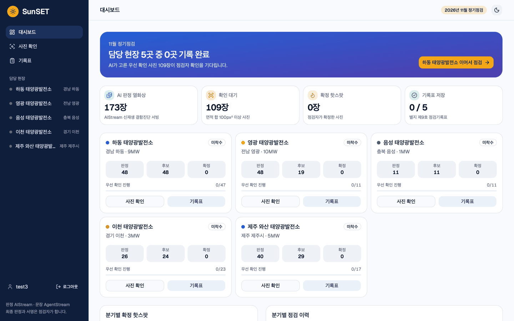
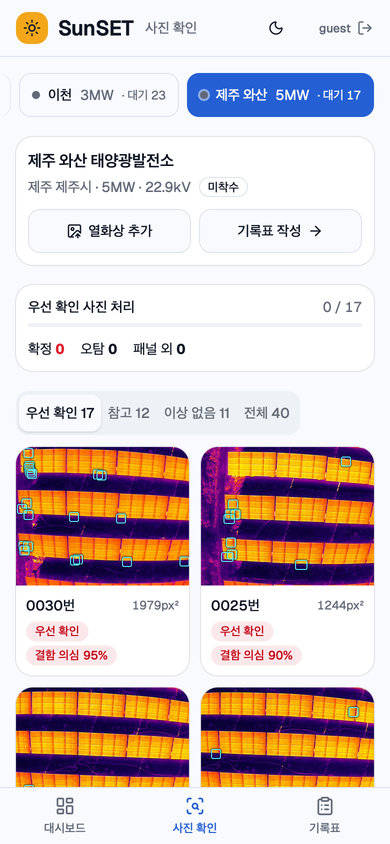
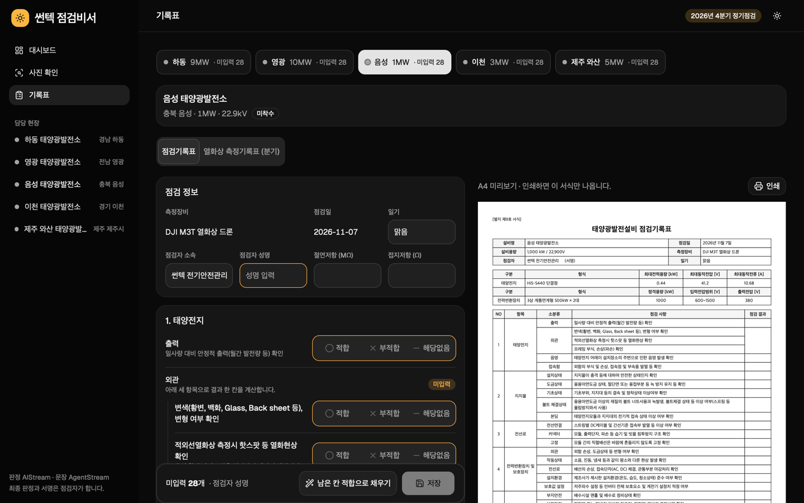
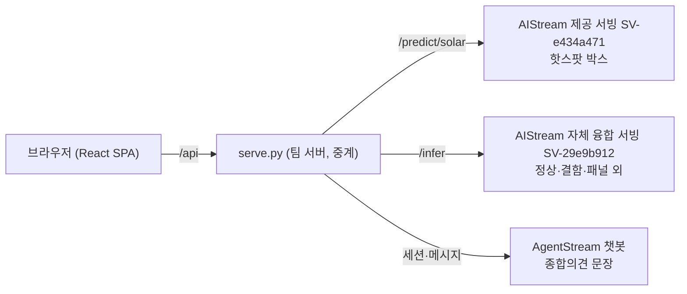

# SunSET

**태양광 정기점검 기록 에이전트**

SunSET(선셋)은 드론 사진을 AI가 먼저 가려 보고 점검자는 확인과 서명만 하는 태양광 정기점검 기록 도우미입니다.


- 서비스 주소: https://devopen-gpu.jntp-ax.or.kr/i/z-kOTvqeFZjwBkOj/
- 체험 계정: guest / guest, test1 / 1234, test2 / 1234, test3 / 1234
- 작업 내용은 브라우저 localStorage에 계정별로 따로 저장합니다.

## 문제와 해결

전기안전관리를 대행하는 점검자는 담당 태양광발전소마다 분기 정기점검을 돌고 법정 서식을 채워야 합니다. 드론으로 찍은 열화상 사진은 현장 한 곳에서만 수백 장이 나옵니다. 이 사진을 한 장씩 넘겨 핫스팟을 찾고 서식에 옮겨 적는 일이 점검 시간의 상당 부분을 차지합니다.

SunSET은 이 과정을 세 단계로 줄입니다.

1. **사진 판정**: AI가 핫스팟 의심 사진을 골라 면적순으로 앞에 놓습니다.
2. **서식 초안**: 점검자가 확인한 결과로 점검기록표와 열화상 측정기록표 초안을 채웁니다.
3. **점검자 확정**: 마지막 판단과 서명은 점검자 몫입니다. 빈칸이 남아 있으면 저장되지 않습니다.

## 주요 기능

**현장 대시보드.** 담당 현장 5곳의 이번 분기 진행 상황을 한 화면에 모았습니다. 판정한 사진 수, 확인을 기다리는 사진, 기록표 저장 여부를 현장별로 보여 줍니다.



**사진 확인.** 핫스팟 박스와 열화상+실화상 융합 판정 배지를 보면서 사진마다 확정, 오탐, 패널 외를 고릅니다. 열화상과 실화상은 슬라이더, 오버랩, 나란히 보기로 비교합니다. 새 사진을 올리면 그 자리에서 판정을 돌립니다.



**기록표 작성.** 별지 제9호 태양광발전설비 점검기록표와 적외선 열화상분포 측정기록표(분기)를 웹에서 고치고 A4로 미리 본 뒤 인쇄합니다. 저장한 기록도 "기록 수정"으로 다시 열 수 있습니다.



**종합의견 초안.** 규칙 코드가 숫자와 ○/× 판정을 정하고, AgentStream 챗봇은 그 요약을 받아 종합의견 문장만 씁니다.

## 구성



모델 추론은 AIStream 서빙에서만 돌고, 문장 생성은 AgentStream에서만 합니다. 팀 서버의 `serve.py`는 요청을 넘기고 응답 형식을 맞추는 일만 맡습니다. 실화상을 열화상 화각에 맞추는 `/api/align`만 팀 서버에서 numpy로 리매핑합니다.

## 모델

| 항목 | 내용 |
|---|---|
| 구조 | 열화상 ResNet18 판정에 실화상 ResNet18 보정항을 더한 융합 분류 |
| 클래스 | 정상, 결함, 패널 외 |
| 학습 데이터 | 대회 드론 데이터 5개 현장, 열화상·실화상 1,098쌍 |
| 제외한 데이터 | AI Hub 데이터는 학습에 쓰지 않았습니다 |
| 서빙 | AIStream 템플릿 `serving/solar_fusion_2팀_안순광` (이 저장소 밖) |

## 폴더

| 경로 | 내용 |
|---|---|
| `src/` | React, TypeScript, Tailwind, shadcn/ui 화면 |
| `src/lib/inspection.ts` | 판정 규칙: 우선 확인 기준, 핫스팟 줄 제안, 외관 칸 계산, 온도차 판정 |
| `serve.py` | 정적 파일 제공과 `/api/*` 중계 |
| `agentstream.py` | AgentStream 세션·메시지 호출과 응답 검증 |
| `scripts/prepare_demo.py` | 시연 사진 재인코딩(EXIF 제거)과 판정값 기록 |
| `scripts/split_samples.py` | 샘플 피커용 `samples.json` 생성 |
| `scripts/align.py` | 실화상을 열화상 틀로 리매핑 |
| `scripts/deploy.sh` | 팀 서버 배포 |
| `docs/kb/` | AgentStream 지식베이스에 올린 팀 작성 문서 |
| `docs/screenshots/` | README 화면 캡처 |

`serve.py`가 중계하는 경로는 다음과 같습니다.

| 경로 | 하는 일 |
|---|---|
| `GET /api/health` | 서빙 상태와 AgentStream 설정 여부 (키 값은 내보내지 않음) |
| `GET /api/samples` | 샘플 피커에 보여 줄 짝 사진 목록 |
| `POST /api/predict/solar` | 핫스팟 박스 판정 |
| `POST /api/classify` | 열화상+실화상 융합 판정 |
| `POST /api/align` | 실화상 정렬본 생성 |
| `POST /api/agent/opinion` | 종합의견 초안 요청 |

## 실행

```bash
bun install
DATA_DIR=data-demo PORT=8601 python3 serve.py   # API 중계, 다른 터미널에서
bun run dev                                      # http://localhost:5173
```

개발 서버는 `/api`와 `/drone` 요청을 8601 포트로 넘깁니다. `/api/align`을 쓰려면 파이썬에 numpy와 pillow가 있어야 합니다.

시연 사진은 용량이 커서 저장소에 넣지 않았습니다. `scripts/prepare_demo.py`가 원본 드론 사진으로 `data-demo/drone/`을 만들고, 서버는 `/data/hackathon/web/data/drone/`에서 사진을 내보냅니다.

## 테스트

```bash
bun test ./src/lib/inspection.test.ts
python3 -m unittest agentstream_test serve_auth_test
bun run build
```

## 배포

```bash
bash scripts/deploy.sh
```

로컬에서 빌드한 결과를 tar와 ssh로 팀 서버 `/data/hackathon/web`에 보냅니다. 서버에 없거나 크기가 다른 시연 사진만 보내고, `.venv`가 없으면 uv로 만든 뒤 `serve.py`를 다시 띄웁니다. 이전 빌드는 `dist.prev`로 남기므로 스크립트가 끝에 출력하는 명령으로 되돌릴 수 있습니다.

## 환경변수

`serve.py`는 같은 폴더의 `.env`를 읽습니다. `.env`는 저장소에 올리지 않습니다.

| 이름 | 설명 |
|---|---|
| `PORT` | 서버 포트, 기본 8501 |
| `DATA_DIR` | 시연 사진 폴더, 기본 `data` |
| `SERVING_URL`, `SERVING_SOLAR_PATH` | 핫스팟 박스 서빙, 기본은 제공 서빙 SV-e434a471 |
| `FUSION_URL`, `FUSION_PATH` | 융합 판정 서빙, 기본은 SV-29e9b912 `/infer` |
| `AGENTSTREAM_BASE_URL`, `AGENTSTREAM_WORKSPACE_ID`, `AGENTSTREAM_CHATBOT_ID`, `AGENTSTREAM_CHAT_PATH` | AgentStream 연동 정보 |
| `AGENTSTREAM_API_KEY` | AgentStream API Key, 서버 `.env`에만 둡니다 |
| `APP_ACCOUNTS` | 로그인 계정 `id:pw,id2:pw2`, 기본 `guest:guest,test1:1234,test2:1234,test3:1234` |
| `SESSION_SECRET` | 세션 쿠키(`sunset_session`) 서명 키, 없으면 서버를 띄울 때마다 새로 만들어 재시작하면 다시 로그인합니다 |

키가 없으면 종합의견을 템플릿 문장으로 채우고 "자동 문장" 표시를 붙입니다.

## 데이터와 서식 출처

- 사진: 대회 제공 서빙과 팀이 확보한 드론 열화상·실화상 사진을 썼고 사용 허가를 받았습니다. 공개 화면의 사진은 EXIF와 촬영 좌표를 지워 다시 저장했습니다. 현장 이름, 용량, 분기별 이력은 시연용 예시 값입니다.
- 서식: 「전기안전관리자의 직무에 관한 고시」(기후에너지환경부고시 제2025-15호) 별지 제9호 태양광발전설비 점검기록표와 적외선 열화상분포 측정기록표의 항목 구조를 따랐습니다.

## 팀

전남광주 기업 AX 혁신 챌린지 2026 2팀 썬텍
